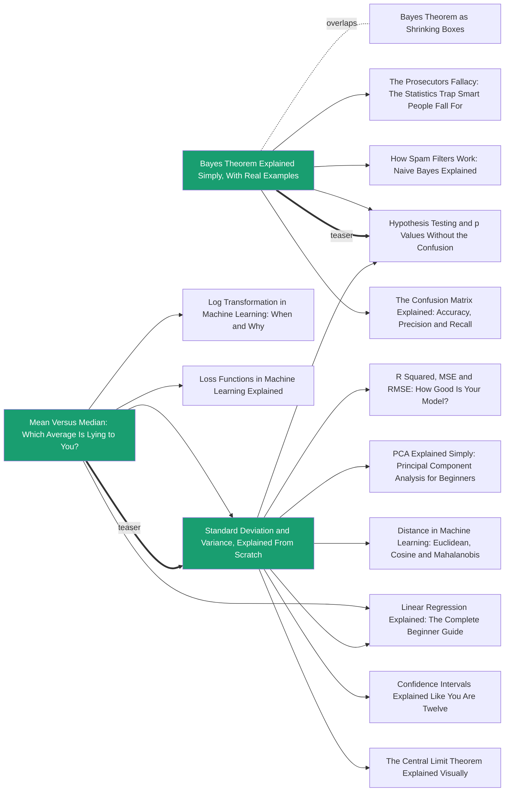

# Math Lab TV: video tracker

_where math is something you can see_ · generated by `python3 math-lab-tv/channel/channel.py render` from [`catalog.json`](catalog.json): edit the data, not this file.

| ⬜ planned | 📝 scripted | 🛠️ in-production | 🎬 produced | ✅ published | total |
|---|---|---|---|---|---|
| 91 | 2 | 0 | 3 | 0 | 96 |

**How to add a YouTube link:** edit [`youtube-links.txt`](youtube-links.txt) (one line: `slug = URL`), or tell Claude "TOPIC is live at URL". The link is used in the descriptions of every connected video.

## Made so far

| Video | Status | Length | Where | Teaser leads to | YouTube |
|---|---|---|---|---|---|
| **Standard Deviation and Variance, Explained From Scratch** (`standard-deviation`) | 🎬 produced | – | script: `math-lab-tv/channel/lesson-lab/standard-deviation/script.txt` | – | add link |
| **Mean Versus Median: Which Average Is Lying to You?** (`mean-vs-median`) | 🎬 produced | 15:50 | `math-lab-tv/mean-vs-median/` | Standard Deviation and Variance, Explained From Scratch | add link |
| **Bayes Theorem Explained Simply, With Real Examples** (`bayes-examples`) | 🎬 produced | 15:12 | `math-lab-tv/bayes-theorem/` | Hypothesis Testing and p Values Without the Confusion | add link |

## Recommended next

1. **Hypothesis Testing and p Values Without the Confusion** (`hypothesis-testing`): promised at the end of *Bayes Theorem Explained Simply, With Real Examples*; builds on *Bayes Theorem Explained Simply, With Real Examples*, *Standard Deviation and Variance, Explained From Scratch*; ML series phase 1; ⚠ not made yet: probability-distributions (give a short intuition)
2. **Linear Regression Explained: The Complete Beginner Guide** (`linear-regression`): builds on *Mean Versus Median: Which Average Is Lying to You?*, *Standard Deviation and Variance, Explained From Scratch*; ML series phase 1
3. **The Confusion Matrix Explained: Accuracy, Precision and Recall** (`confusion-matrix`): builds on *Bayes Theorem Explained Simply, With Real Examples*; ML series phase 1
4. **How Spam Filters Work: Naive Bayes Explained** (`naive-bayes`): builds on *Bayes Theorem Explained Simply, With Real Examples*; ML series phase 3
5. **The Prosecutors Fallacy: The Statistics Trap Smart People Fall For** (`prosecutors-fallacy`): builds on *Bayes Theorem Explained Simply, With Real Examples*; ML series phase 3

## How the made videos connect

Arrows point from a video to the topics that build on it; a thick arrow is the on-screen teaser.

## The Maths Under Machine Learning  (3/36 made)

_The statistics and linear algebra every model is made of. Thirty six lessons, in priority order._

| # | | Title | Builds on | Leads to | Overlaps | YouTube |
|---|---|---|---|---|---|---|
| 1 · P1 | 🎬 | **Standard Deviation and Variance, Explained From Scratch** `standard-deviation` | `mean-vs-median` | `linear-regression`, `hypothesis-testing`, `clt-visual`, `confidence-intervals`, `regression-metrics`, `pca`, `distance-metrics` |  |  |
| 2 · P1 | 🎬 | **Mean Versus Median: Which Average Is Lying to You?** `mean-vs-median` |  | `standard-deviation`, `linear-regression`, `loss-functions`, `log-transformation` |  |  |
| 3 · P1 | 🎬 | **Bayes Theorem Explained Simply, With Real Examples** `bayes-examples` | `probability-for-ml` | `hypothesis-testing`, `confusion-matrix`, `naive-bayes`, `prosecutors-fallacy` | `bayes` |  |
| 4 · P1 | ⬜ | **Linear Regression Explained: The Complete Beginner Guide** `linear-regression` | `mean-vs-median`, `standard-deviation` | `gradient-descent`, `loss-functions`, `logistic-regression`, `regression-metrics`, `multiple-regression` |  |  |
| 5 · P1 | ⬜ | **Gradient Descent Visualized: How AI Actually Learns** `gradient-descent` | `linear-regression`, `derivative` |  |  |  |
| 6 · P1 | ⬜ | **Hypothesis Testing and p Values Without the Confusion** `hypothesis-testing` | `bayes-examples`, `probability-distributions`, `standard-deviation` |  |  |  |
| 7 · P1 | ⬜ | **Probability for Machine Learning: The Basics You Actually Need** `probability-for-ml` |  | `bayes-examples`, `probability-distributions`, `logistic-regression`, `random-variables`, `entropy-information-gain` |  |  |
| 8 · P1 | ⬜ | **The Confusion Matrix Explained: Accuracy, Precision and Recall** `confusion-matrix` | `bayes-examples` | `roc-curve` |  |  |
| 9 · P1 | ⬜ | **Matrix Multiplication for Machine Learning: A Visual Guide** `matmul-for-ml` | `vectors-norms` | `inverse-rank-determinant`, `convolutions`, `matrix-image-transforms`, `regression-matrices` | `matrix-multiplication` |  |
| 10 · P1 | ⬜ | **The Central Limit Theorem Explained Visually** `clt-visual` | `standard-deviation`, `histograms` | `confidence-intervals` | `central-limit` |  |
| 11 · P2 | ⬜ | **Probability Distributions for Data Science: Normal, Binomial and More** `probability-distributions` | `probability-for-ml`, `histograms` | `hypothesis-testing` |  |  |
| 12 · P2 | ⬜ | **Confidence Intervals Explained Like You Are Twelve** `confidence-intervals` | `clt-visual`, `standard-deviation` |  |  |  |
| 13 · P2 | ⬜ | **Vectors, Norms and Distance for Machine Learning** `vectors-norms` |  | `matmul-for-ml`, `pca`, `why-linear-algebra`, `tf-idf`, `distance-metrics` |  |  |
| 14 · P2 | ⬜ | **Loss Functions in Machine Learning Explained** `loss-functions` | `mean-vs-median`, `linear-regression` | `regularization` |  |  |
| 15 · P2 | ⬜ | **Logistic Regression Explained: Who Survived the Titanic?** `logistic-regression` | `linear-regression`, `probability-for-ml` |  |  |  |
| 16 · P2 | ⬜ | **R Squared, MSE and RMSE: How Good Is Your Model?** `regression-metrics` | `linear-regression`, `standard-deviation` |  |  |  |
| 17 · P2 | ⬜ | **PCA Explained Simply: Principal Component Analysis for Beginners** `pca` | `standard-deviation`, `eigenvectors`, `vectors-norms` |  |  |  |
| 18 · P2 | ⬜ | **The ROC Curve Explained Simply** `roc-curve` | `confusion-matrix` |  |  |  |
| 19 · P2 | ⬜ | **Histograms and Data Distributions Explained Simply** `histograms` | `data-types` | `clt-visual`, `probability-distributions`, `log-transformation` |  |  |
| 20 · P2 | ⬜ | **Expected Value and Variance: Random Variables Made Easy** `random-variables` | `probability-for-ml` |  | `expected-value` |  |
| 21 · P2 | ⬜ | **Types of Data in Statistics: Nominal, Ordinal, Interval and Ratio** `data-types` |  | `histograms` |  |  |
| 22 · P2 | ⬜ | **Why Machine Learning Needs Linear Algebra** `why-linear-algebra` | `vectors-norms` |  |  |  |
| 23 · P3 | ⬜ | **Matrix Inverse, Rank and Determinant Explained Simply** `inverse-rank-determinant` | `matmul-for-ml` | `regression-matrices` | `determinant` |  |
| 24 · P3 | ⬜ | **How Spam Filters Work: Naive Bayes Explained** `naive-bayes` | `bayes-examples` |  |  |  |
| 25 · P3 | ⬜ | **TF IDF Explained: How Search Engines Rank Words** `tf-idf` | `vectors-norms` |  |  |  |
| 26 · P3 | ⬜ | **Entropy and Information Gain: How a Decision Tree Decides** `entropy-information-gain` | `probability-for-ml` |  |  |  |
| 27 · P3 | ⬜ | **Distance in Machine Learning: Euclidean, Cosine and Mahalanobis** `distance-metrics` | `vectors-norms`, `standard-deviation` | `gps` |  |  |
| 28 · P3 | ⬜ | **Multiple Regression and Dummy Variables Explained** `multiple-regression` | `linear-regression` | `regularization`, `regression-matrices`, `interaction-effects`, `diff-in-diff` |  |  |
| 29 · P3 | ⬜ | **Ridge, Lasso and Elastic Net: Regularization Explained** `regularization` | `multiple-regression`, `loss-functions` |  |  |  |
| 30 · P3 | ⬜ | **Convolutions Explained: How Image Filters Work** `convolutions` | `matmul-for-ml` |  |  |  |
| 31 · P3 | ⬜ | **The Prosecutors Fallacy: The Statistics Trap Smart People Fall For** `prosecutors-fallacy` | `bayes-examples` |  |  |  |
| 32 · P3 | ⬜ | **How Matrices Rotate and Scale Images** `matrix-image-transforms` | `matmul-for-ml` |  |  |  |
| 33 · P3 | ⬜ | **Log Transformation in Machine Learning: When and Why** `log-transformation` | `histograms`, `mean-vs-median` |  |  |  |
| 34 · P4 | ⬜ | **Linear Regression With Matrices: The Maths Behind the Model** `regression-matrices` | `multiple-regression`, `matmul-for-ml`, `inverse-rank-determinant` |  |  |  |
| 35 · P4 | ⬜ | **Interaction Effects in Regression Explained Simply** `interaction-effects` | `multiple-regression` | `diff-in-diff` |  |  |
| 36 · P4 | ⬜ | **Difference in Differences Explained: Causal Inference for Beginners** `diff-in-diff` | `multiple-regression`, `interaction-effects` |  |  |  |

## Seeing Why  (0/8 made)

_Short, surprising visual proofs. No prerequisites._

| # | | Title | Builds on | Leads to | Overlaps | YouTube |
|---|---|---|---|---|---|---|
| 1 | 📝 | **Why Does a Squared Plus b Squared Equal c Squared?** `pythagoras` |  | `gps` |  |  |
| 2 | ⬜ | **Adding 1 to 100 Without Adding** `gauss-sum` |  | `handshakes` |  |  |
| 3 | ⬜ | **Why Is a Circle's Area pi r Squared?** `circle-area` |  |  |  |  |
| 4 | ⬜ | **Pi Is Hiding Inside a Square** `pi-in-a-square` |  |  |  |  |
| 5 | ⬜ | **The Square That Proves an Infinite Sum** `infinite-sum` |  | `point-nine-repeating` |  |  |
| 6 | ⬜ | **Why Zero Point Nine Repeating Equals One** `point-nine-repeating` | `infinite-sum` |  |  |  |
| 7 | ⬜ | **The Handshake Problem** `handshakes` | `gauss-sum` |  |  |  |
| 8 | ⬜ | **Why You Cannot Trisect an Angle** `angle-trisection` |  |  |  |  |

## Calculus, Built From Scratch  (0/8 made)

_The course, in the order it should have been taught._

| # | | Title | Builds on | Leads to | Overlaps | YouTube |
|---|---|---|---|---|---|---|
| 1 | ⬜ | **What a Derivative Really Is** `derivative` |  | `gradient-descent`, `chain-rule`, `ftc`, `taylor`, `why-e`, `epsilon-delta`, `heat-equation` |  |  |
| 2 | ⬜ | **The Chain Rule, Drawn as Gears** `chain-rule` | `derivative` | `related-rates`, `neural-nets` |  |  |
| 3 | ⬜ | **Integration Is Just Adding Slices** `integral` |  | `ftc` |  |  |
| 4 | ⬜ | **The Fundamental Theorem, in One Animation** `ftc` | `derivative`, `integral` |  |  |  |
| 5 | ⬜ | **Building a Curve Out of Polynomials** `taylor` | `derivative` |  |  |  |
| 6 | ⬜ | **Why e Is Everywhere** `why-e` | `derivative` |  |  |  |
| 7 | ⬜ | **Related Rates Without Panic** `related-rates` | `chain-rule` |  |  |  |
| 8 | ⬜ | **The Epsilon Delta Definition, Finally Visual** `epsilon-delta` | `derivative` |  |  |  |

## Linear Algebra Is Geometry  (0/8 made)

_Matrices as motion, not arithmetic._

| # | | Title | Builds on | Leads to | Overlaps | YouTube |
|---|---|---|---|---|---|---|
| 1 | ⬜ | **Vectors Are Arrows, Matrices Are Motions** `vectors-matrices` |  | `determinant`, `eigenvectors`, `matrix-multiplication`, `linear-dependence`, `change-of-basis` |  |  |
| 2 | ⬜ | **The Determinant Is How Much Area Got Stretched** `determinant` | `vectors-matrices` |  | `inverse-rank-determinant` |  |
| 3 | ⬜ | **Eigenvectors: The Directions That Do Not Turn** `eigenvectors` | `vectors-matrices` | `pca`, `svd`, `pagerank` |  |  |
| 4 | ⬜ | **Matrix Multiplication Is Composition** `matrix-multiplication` | `vectors-matrices` | `neural-nets` | `matmul-for-ml` |  |
| 5 | ⬜ | **What Does Linearly Dependent Look Like?** `linear-dependence` | `vectors-matrices` |  |  |  |
| 6 | ⬜ | **Same Vector, Different Language** `change-of-basis` | `vectors-matrices` | `svd` |  |  |
| 7 | ⬜ | **Every Matrix Is a Rotate, Stretch, Rotate** `svd` | `eigenvectors`, `change-of-basis` |  |  |  |
| 8 | ⬜ | **Why Neural Networks Are Mostly Linear Algebra** `neural-nets` | `matrix-multiplication`, `chain-rule` |  |  |  |

## Probability That Breaks Your Intuition  (0/8 made)

_The results people argue about in the comments._

| # | | Title | Builds on | Leads to | Overlaps | YouTube |
|---|---|---|---|---|---|---|
| 1 | 📝 | **The Monty Hall Problem, One Thousand Games at Once** `monty-hall` |  |  |  |  |
| 2 | ⬜ | **Twenty Three People, Fifty Fifty Odds** `birthday-paradox` |  |  |  |  |
| 3 | ⬜ | **Bayes Theorem as Shrinking Boxes** `bayes` |  |  | `bayes-examples` |  |
| 4 | ⬜ | **Why the Bell Curve Appears Out of Nowhere** `central-limit` |  |  | `clt-visual` |  |
| 5 | ⬜ | **Simpsons Paradox: When the Trend Reverses** `simpsons-paradox` |  |  |  |  |
| 6 | ⬜ | **The Gamblers Ruin** `gamblers-ruin` | `expected-value` |  |  |  |
| 7 | ⬜ | **Finding Pi by Dropping Sticks** `buffon-needle` |  |  |  |  |
| 8 | ⬜ | **Expected Value Versus What Happens to You** `expected-value` |  | `gamblers-ruin`, `optimal-stopping` | `random-variables` |  |

## Fourier and Waves  (0/6 made)

_The visual showpieces._

| # | | Title | Builds on | Leads to | Overlaps | YouTube |
|---|---|---|---|---|---|---|
| 1 | ⬜ | **Any Shape, Drawn With Circles** `epicycles` |  | `fourier-transform` |  |  |
| 2 | ⬜ | **What a Fourier Transform Actually Does** `fourier-transform` | `epicycles` | `compression`, `heat-equation`, `harmonics`, `uncertainty` |  |  |
| 3 | ⬜ | **Why Your Music Files Are So Small** `compression` | `fourier-transform` |  |  |  |
| 4 | ⬜ | **The Heat Equation and Fouriers Big Idea** `heat-equation` | `fourier-transform`, `derivative` |  |  |  |
| 5 | ⬜ | **Why a Violin and a Flute Sound Different** `harmonics` | `fourier-transform` |  |  |  |
| 6 | ⬜ | **The Uncertainty Principle Is Just Maths** `uncertainty` | `fourier-transform` |  |  |  |

## Number Theory and Primes  (0/7 made)

_The oldest questions, still open._

| # | | Title | Builds on | Leads to | Overlaps | YouTube |
|---|---|---|---|---|---|---|
| 1 | ⬜ | **The Sieve of Eratosthenes** `sieve` |  | `riemann` |  |  |
| 2 | ⬜ | **Why There Are Infinitely Many Primes** `infinite-primes` |  | `rsa`, `riemann` |  |  |
| 3 | ⬜ | **Maths on a Clock** `modular` |  | `rsa` |  |  |
| 4 | ⬜ | **How RSA Encryption Works, With Small Numbers** `rsa` | `modular`, `infinite-primes` |  |  |  |
| 5 | ⬜ | **The Collatz Conjecture: Nobody Knows Why** `collatz` |  |  |  |  |
| 6 | ⬜ | **Fibonacci, the Golden Ratio and Sunflowers** `fibonacci` |  |  |  |  |
| 7 | ⬜ | **The Riemann Hypothesis, Explained Honestly** `riemann` | `infinite-primes`, `sieve` |  |  |  |

## Shapes, Chaos and Dimensions  (0/8 made)

_Where maths becomes art._

| # | | Title | Builds on | Leads to | Overlaps | YouTube |
|---|---|---|---|---|---|---|
| 1 | ⬜ | **Shapes With Fractional Dimension** `fractals` |  | `mandelbrot` |  |  |
| 2 | ⬜ | **The Mandelbrot Set: Infinite Zoom, One Rule** `mandelbrot` | `fractals` |  |  |  |
| 3 | ⬜ | **Why Weather Cannot Be Predicted** `chaos` |  | `logistic-map` |  |  |
| 4 | ⬜ | **One Equation, Infinite Complexity** `logistic-map` | `chaos` |  |  |  |
| 5 | ⬜ | **A Shape With Only One Side** `mobius` |  |  |  |  |
| 6 | ⬜ | **Seven Bridges and the Birth of Graph Theory** `konigsberg` |  |  |  |  |
| 7 | ⬜ | **What a Four Dimensional Cube Looks Like** `fourth-dimension` |  |  |  |  |
| 8 | ⬜ | **When Parallel Lines Meet** `non-euclidean` |  |  |  |  |

## Maths in the Wild  (0/7 made)

_Applied, and aimed at the widest audience._

| # | | Title | Builds on | Leads to | Overlaps | YouTube |
|---|---|---|---|---|---|---|
| 1 | ⬜ | **How GPS Does Geometry to Find You** `gps` | `pythagoras`, `distance-metrics` |  |  |  |
| 2 | ⬜ | **Why Honeycombs Are Hexagons** `honeycomb` |  |  |  |  |
| 3 | ⬜ | **The Maths Behind Googles Search Ranking** `pagerank` | `eigenvectors` |  |  |  |
| 4 | ⬜ | **When Is a Deck Truly Shuffled?** `shuffling` |  |  |  |  |
| 5 | ⬜ | **Why Traffic Jams Form With No Accident** `traffic` |  |  |  |  |
| 6 | ⬜ | **The Thirty Seven Percent Rule** `optimal-stopping` | `expected-value` |  |  |  |
| 7 | ⬜ | **How Compound Interest Quietly Wins** `compound-interest` |  |  |  |  |

---
Status key: ⬜ **planned**: not started · 📝 **scripted**: a draft script exists · 🛠️ **in-production**: script approved, voice/animation under way · 🎬 **produced**: final MP4 + YouTube package ready, not yet linked · ✅ **published**: live on YouTube (link recorded)
